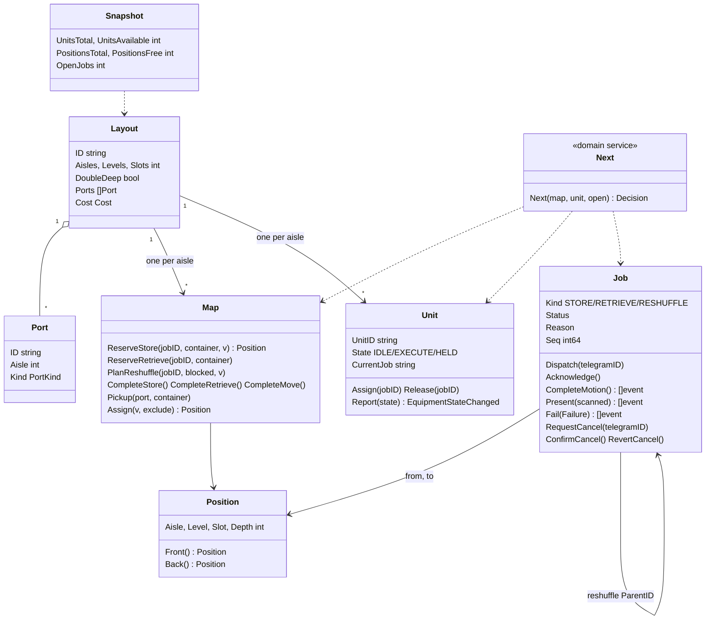

# Class diagram

Events are plain structs next to their aggregates: `storagejob.ContainerStored`, `ContainerPresentedAtPort`,
`StorageJobFailed`, `equipment.EquipmentStateChanged`, `capacity.AsrsCapacityChanged`.
