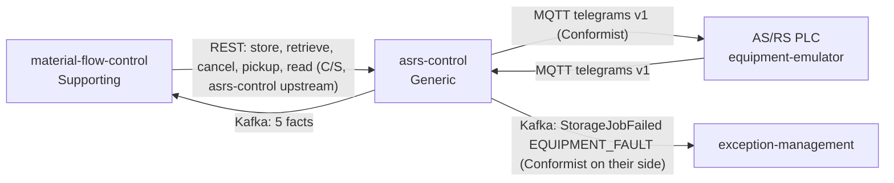

# Context Map

The relationships are the WCS context map's ([WCS context map](https://iqvo.github.io/warehouse-docs/wcs/context-map), warehouse-docs), as built
([ADR 0001](/docs/adr/0001-asrs-control-bounded-context)).

| # (WCS map) | Neighbour | Pattern | Edge | Status |
| --- | --- | --- | --- | --- |
| 5 | material-flow-control | **Customer/Supplier**, asrs-control supplies the subsystem-controller interface | REST `apis/openapi.yaml`; Kafka `warehouse.asrs-control.events` (all five types) | both sides built (material-flow-control v0.1.0 declares and handles all five types) |
| 7 | AS/RS PLC (equipment-emulator) | **Conformist** to telegram protocol v1 | MQTT `asrs/v1/<asrsId>/down` and `/up` | built, end-to-end tested against the emulator image |
| 8 | exception-management | **Conformist** on exception-management's side | consumes `StorageJobFailed`; reason `EQUIPMENT_FAULT` opens a case | published; the consumer is not wired yet |

No call to any other context and no Kafka consumer. `inventory-storage` (contents, the stock ledger), `facility-layout`
(the AS/RS as one `AutomatedStorage` location) and `fulfillment-execution`/`wes-work-planning` (what moves when) are
reached only through material-flow-control. The layout of each AS/RS is configuration, not a sibling's data
([ADR 0002](/docs/adr/0002-telegram-conformance-and-aisle-scheduling) decision 7).
