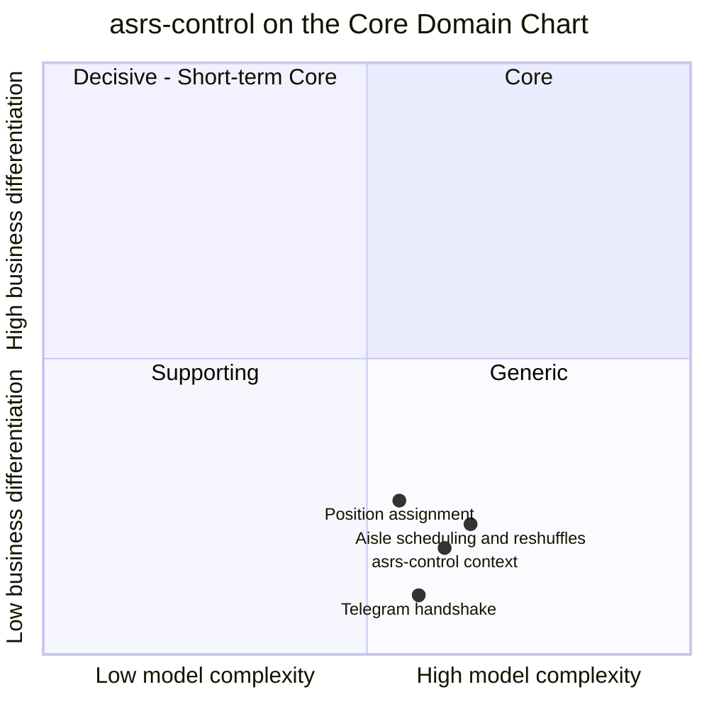

# Core Domain Chart

Following the ddd-crew [Core Domain Charts](https://github.com/ddd-crew/core-domain-charts): business differentiation (y)
against model complexity (x).

Source: the Generic classification is the WCS design's ([WCS subdomains](https://iqvo.github.io/warehouse-docs/wcs/subdomains), warehouse-docs); the coordinates are
this pack's placement, consistent with it. The slices correspond to `internal/domain/storagemap/assign.go` (position
assignment), `internal/domain/scheduling` with `internal/application/usecases/schedule.go` (aisle scheduling and
reshuffles) and `internal/adapters/telegram` with `internal/adapters/mqtt` (the handshake).

## Classification: Generic

**Differentiation is low (y = 0.18).** An AS/RS controller is bought with the hardware in practice; no business wins by
assigning rack positions differently. The fleet needs one so material-flow-control has a real subsystem to drive.

**Complexity is moderate to high (x = 0.62).** Double-deep depth rules, reshuffles chosen at dispatch, strict port order,
one job per aisle, and a handshake with retransmits, duplicates and boot recovery make it more than a CRUD service.

That combination (complex but not differentiating) is the Generic quadrant: keep it behind a stable interface so it could
be swapped for a vendor product.
