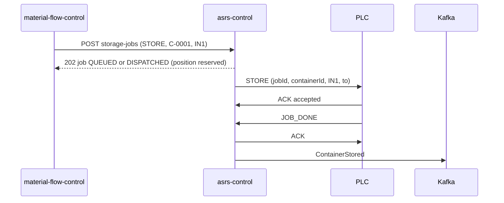
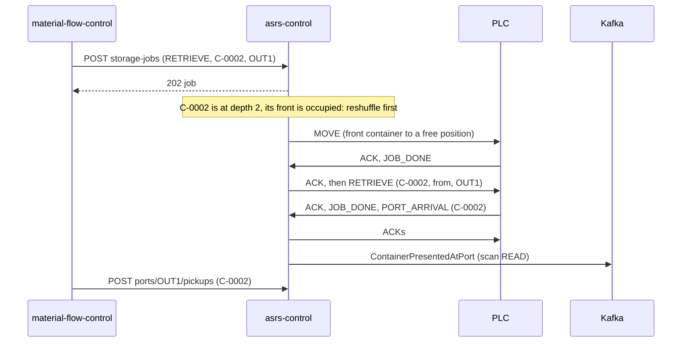

# Domain Message Flow

Following the ddd-crew [Domain Message Flow Modelling](https://github.com/ddd-crew/domain-message-flow-modelling).

## Store

## Retrieve behind a blocking container

The MOVE publishes nothing (invariant 6). Every event goes to both `warehouse.asrs-control.events` and
`warehouse.asrs-control.analytics`; `AsrsCapacityChanged` follows whenever units available, free positions or open jobs
change.
