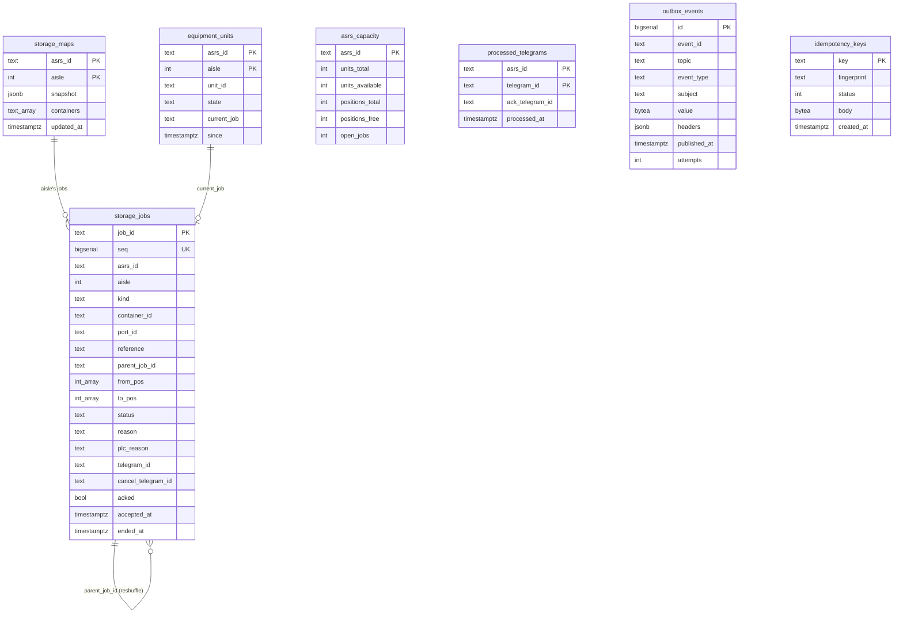

# Entity relationship

One migration, `migrations/0001_asrs_control_schema.up.sql`, run at boot by golang-migrate.

| Table | Notes |
| --- | --- |
| `storage_maps` | One row per (AS/RS, aisle); the map is a JSONB snapshot, `containers` a GIN-indexed array for "which aisle holds C". The row is the aisle lock. |
| `storage_jobs` | `seq` is the acceptance order the scheduler trusts. `uq_storage_jobs_open_external` allows one open STORE/RETRIEVE per (AS/RS, container); it closes the race between aisles. |
| `equipment_units` | One per aisle, locked after the map. |
| `asrs_capacity` | The last published snapshot; its row lock serialises capacity changes across aisles. |
| `processed_telegrams` | The up-telegram inbox: (AS/RS, telegram id) → the ACK id sent. Purged after 24 h. |
| `outbox_events` | Two rows per event (events and analytics), same `event_id`. |
| `idempotency_keys` | Stored 2xx and FINAL answers, 24 h window, purged hourly. |
