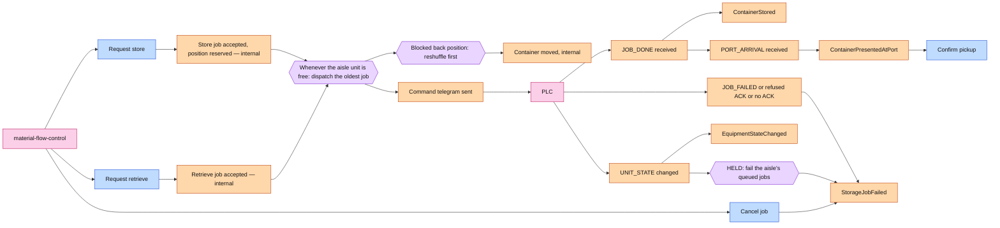

# EventStorming

Process level, read left to right. Commands are blue, events orange, policies lilac, external systems pink.

## Hot spots

- No job-state query in protocol v1: a JOB_DONE lost while asrs-control is down longer than about 8 s leaves the job
  ACKNOWLEDGED (ADR 0002 known limits).
- A CANCEL the PLC accepted whose ACK and retransmits are all lost leaves the job waiting; deliberately not auto-failed.
- No telegram reports a container leaving an output port: the pickup confirmation is the only signal.
