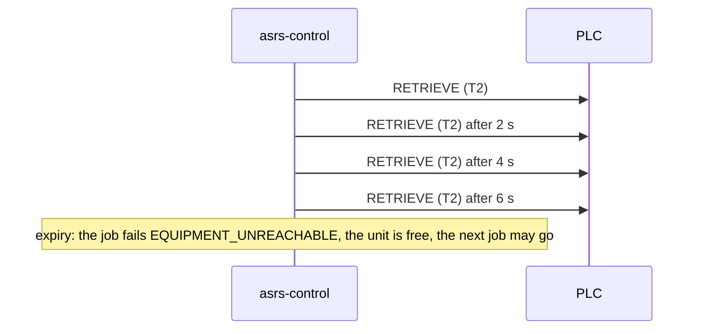
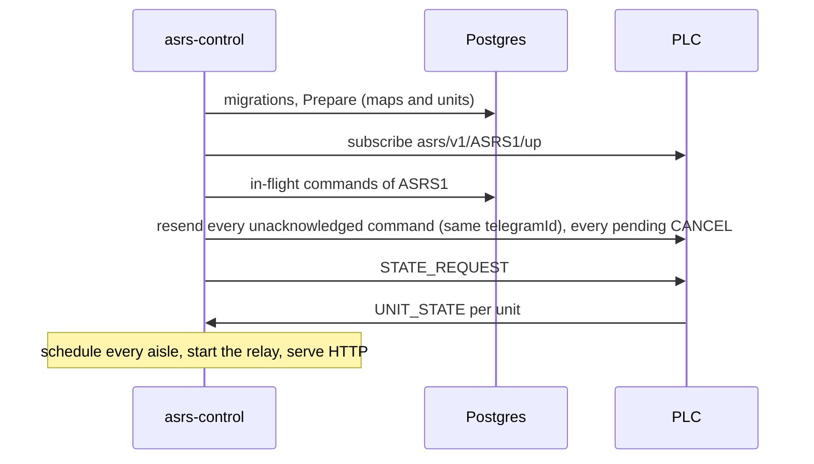

# Sequence diagrams

## Handshake and duplicate

```mermaid
sequenceDiagram
  participant A as asrs-control
  participant DB as Postgres
  participant P as PLC
  P->>A: JOB_DONE (telegramId T1)
  A->>DB: BEGIN; lock aisle; claim T1 with ACK id K1; apply; COMMIT
  A->>P: ACK (K1, ackTelegramId T1)
  Note over P: the ACK was lost; the PLC retransmits after 2 s
  P->>A: JOB_DONE (T1 again)
  A->>DB: claim T1: already claimed with K1, change nothing
  A->>P: ACK (K1) again
```

## Cancel a job the PLC holds

```mermaid
sequenceDiagram
  participant MFC as material-flow-control
  participant A as asrs-control
  participant P as PLC
  MFC->>A: POST .../cancellation
  A-->>MFC: 202 CANCEL_REQUESTED
  A->>P: CANCEL (jobId)
  alt accepted
    P->>A: ACK accepted
    Note over A: CANCELLED, StorageJobFailed reason CANCELLED
  else refused or no ACK after 3 retransmits
    P->>A: ACK refused
    Note over A: reverted to ACKNOWLEDGED (or DISPATCHED); the job runs to its outcome
  end
```

## A command the PLC never answers



## Boot recovery


