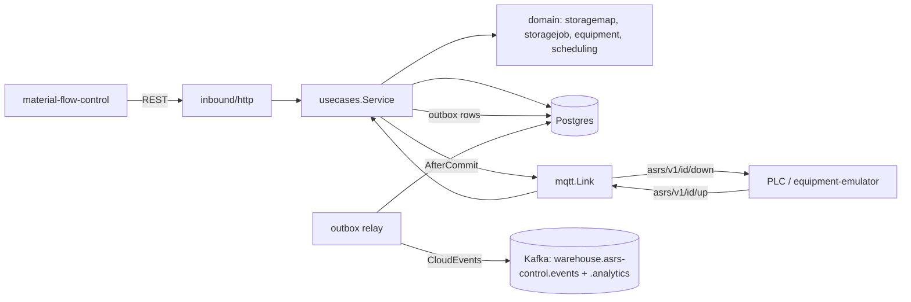

# Architecture

asrs-control is one Go binary, `cmd/api`, built hexagonally. `internal/architecture/architecture_test.go` (arch-go) and
the other fitness tests in `internal/architecture/` fail the build when a layer imports the wrong way.

```text
cmd/api                              composition root: config, wiring, run and drain
internal/domain/
  layout                             the AS/RS structure, positions, ports, travel cost
  storagemap                         StorageMap aggregate (one per aisle), assignment, motion
  storagejob                         StorageJob aggregate, transitions, events, reasons
  equipment                          EquipmentUnit aggregate (PackML state, one job)
  capacity                           the capacity snapshot and its change event
  scheduling                         Next: the aisle's next action (pure)
internal/application/
  ports                              repositories, UnitOfWork, Clock, IDs, EventSink, Downlink, ProcessedTelegrams
  usecases                           one Service: requests, commands, uplink, acks, recover, queries
  telegrams                          the application's view of telegram protocol v1
  outbox, idempotency                outbox message and idempotency record types
internal/adapters/
  inbound/http                       REST, problem+json, Idempotency-Key middleware, probes
  mqtt                               the PLC link: paho client, ordered inbox, retransmitter wiring
  telegram                           protocol v1 codec, ACKs, retransmitter
  kafka/cloudevents                  the one CloudEvents 1.0 helper
  outbound/postgres                  repositories, unit of work, outbox, inbox, idempotency store, migrations
  outbound/events                    domain events -> CloudEvents outbox rows (events + analytics)
  outbound/outbox, outbound/kafka    the relay and its kafka-go writer
  outbound/memory                    in-memory doubles for unit tests and godog only
  outbound/system                    clock and UUIDs
internal/config                      the layout file loader
```

## Component view



## The aisle unit of work

Every write runs in one `ports.UnitOfWork` around **one aisle** (`usecases.Service.inAisle`): it locks the aisle's
`storage_maps` row (`SELECT ... FOR UPDATE`), then its `equipment_units` row, loads the map, the unit and the aisle's
open jobs, applies the change, asks the scheduler (`scheduling.Next`) until it dispatches a job or has nothing to do (at most
256 decisions per pass), saves the map and the unit, refreshes the capacity snapshot (its row lock serialises it across
aisles) and appends the resulting events to the outbox, then commits. So the map, the unit and the jobs of one
aisle change serially, and invariant 3 holds by construction ([ADR 0002](/docs/adr/0002-telegram-conformance-and-aisle-scheduling)
decision 3). The `Idempotency-Key` middleware opens the outer unit of work of every POST; `Do` joins it.

Down telegrams are sent only from a `UnitOfWork.AfterCommit` hook of the **outermost** unit of work: nothing is sent for
state that rolled back, and a command is never on the wire before the job row its ACK must find.

## The PLC link

`internal/adapters/mqtt.Link` is one MQTT client per AS/RS (`<MQTT_CLIENT_ID>-<asrsId>`), subscribed to
`asrs/v1/<asrsId>/up` on every (re)connection. paho runs with ordered delivery; its callback only enqueues, and one worker
per link applies up telegrams and retransmit expiries in order. The retransmitter resends an unacknowledged command
after 2 s real time, at most 3 times, then reports an expiry. Up telegrams are claimed in `processed_telegrams` inside the
effect's transaction with the ACK id, so a duplicate gets the identical ACK. See the
[event and telegram catalogue](/docs/api-reference/events).

## Publishing

Domain events go through `internal/adapters/outbound/events.Sink`, which mints one CloudEvents `id` per occurrence and
writes two outbox rows (integration and analytics) in the same transaction. The relay (`outbound/outbox`) polls
unpublished rows every `OUTBOX_INTERVAL_MS`, publishes them with kafka-go (key = `subject`, hash balancer) and marks them
published ([ADR 0003](/docs/adr/0003-cloudevents-envelope-and-type-catalogue)).

## Boot and shutdown

`cmd/api` loads and validates the layout file, runs the migrations (`MIGRATIONS_DATABASE_URL`, else `DATABASE_URL`),
opens the pool, creates every aisle's map and unit (`Prepare`), connects the links, starts them, runs `Recover` per AS/RS
(resend unacknowledged commands and pending CANCELs, STATE_REQUEST, schedule every aisle), starts the relay and the hourly
purger, and serves HTTP. On SIGTERM it flips `/readyz` to not ready and drains HTTP for at most 10 s. Boot refuses a layout
that no longer contains a stored container's position.

## Fitness tests

`internal/architecture/` holds the arch-go layer rules plus the fleet sensors: no memory adapter at runtime
(`runtime_no_memory_fitness_test.go`), the event catalogue matches the contract (`catalogue_fitness_test.go`), Kafka
writer acks, timeout and topic rules, the outbox relay cap, the DLQ shutdown rule, the MCP and A2A authority rules, the agent
adapter dependency rules and the read-only allowlist of `cmd/mcp` and `cmd/a2a` (`agent_readonly_fitness_test.go`, ADR
0005), no Go files at the root, and the no-auth and envelope rules in `fitness_test.go`.
